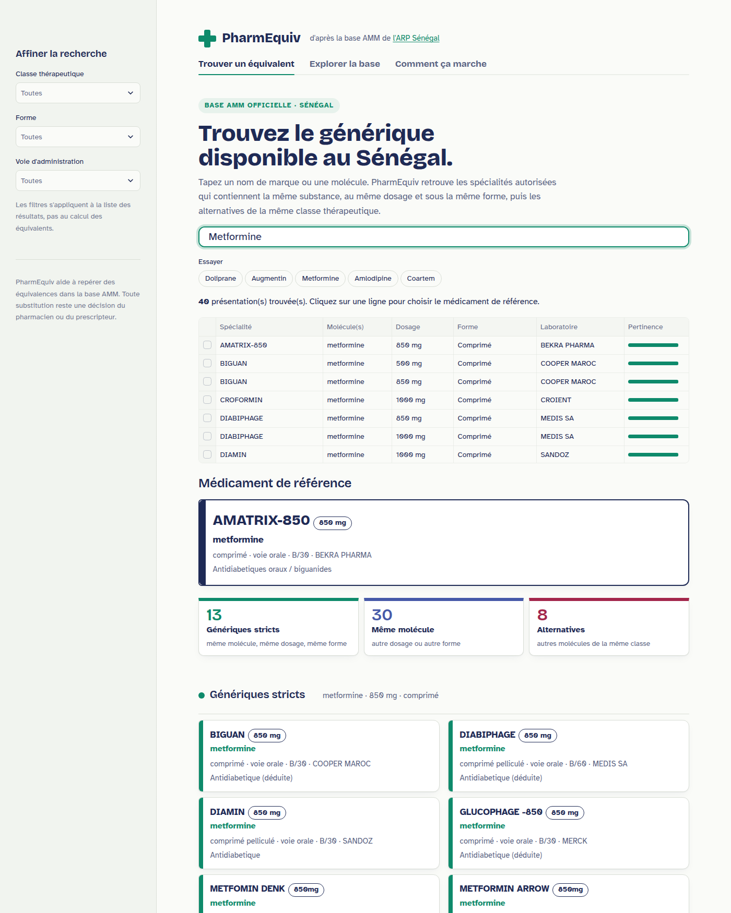
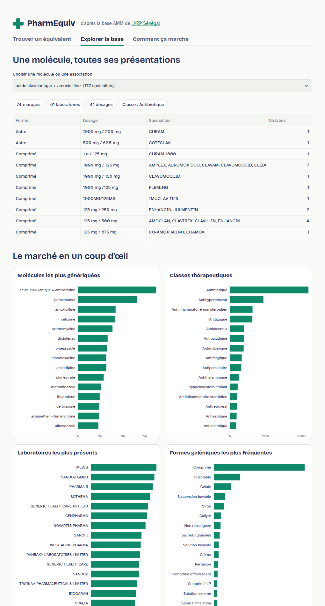

# PharmEquiv — moteur d'équivalence et de recherche de génériques

PharmEquiv retrouve, à partir d'un nom de marque ou d'une molécule, les médicaments
**autorisés au Sénégal** qui peuvent le remplacer. Les données viennent de la base
publique des Autorisations de Mise sur le Marché (AMM) de l'**Agence sénégalaise de
Réglementation Pharmaceutique (ARP)**.



---

## Sommaire

1. [Le but](#le-but)
2. [Ce que fait l'application](#ce-que-fait-lapplication)
3. [Démarrer en 2 minutes](#démarrer-en-2-minutes)
4. [Architecture](#architecture)
5. [Comment fonctionne le moteur](#comment-fonctionne-le-moteur)
6. [Mettre à jour les données](#mettre-à-jour-les-données)
7. [Déployer](#déployer)
8. [Tests et qualité](#tests-et-qualité)
9. [Limites et avertissement](#limites-et-avertissement)
10. [Auteurs](#auteurs)
11. [Licence](#licence)

---

## Le but

Au comptoir, un pharmacien ou un patient se pose souvent la même question :
*« Ce médicament est en rupture ou trop cher. Qu'est-ce qui existe d'équivalent ? »*

La base de l'ARP contient plus de 7 000 spécialités, mais elle est difficile à
exploiter telle quelle : la même molécule y est écrite de dizaines de façons
(« AMOXCILLINE », « Amoxicilline trihydrate », « amoxiciline »…), les dosages aussi
(« 1 g », « 1000mg »), et plus d'un tiers des lignes n'ont pas de classe thérapeutique.

PharmEquiv nettoie ces données, les rend comparables, et répond en une recherche.

## Ce que fait l'application

| Onglet | Rôle |
|---|---|
| **Trouver un équivalent** | Recherche tolérante aux fautes (nom de marque ou DCI), choix d'un médicament de référence, puis affichage de ses équivalents sur **trois niveaux**. Export CSV. |
| **Explorer la base** | Toutes les présentations d'une molécule (formes, dosages, marques, laboratoires) et une vue d'ensemble du marché. |
| **Comment ça marche** | La méthode et ses limites, expliquées aux utilisateurs. |

Les trois niveaux d'équivalence :

| Niveau | Règle | Usage |
|---|---|---|
| 🟩 **Générique strict** | même DCI + même dosage + même famille de forme | substitution directe envisageable |
| 🟦 **Même molécule** | même DCI, dosage ou forme différents | adapter la posologie |
| 🟥 **Alternative thérapeutique** | même famille de classe + même voie, autre DCI | nécessite un avis médical |



## Démarrer en 2 minutes

Prérequis : **Python 3.10+**.

```bash
# 1. Récupérer le projet
git clone <url-du-depot> PharmEquiv
cd PharmEquiv

# 2. Créer un environnement virtuel
python -m venv .venv
source .venv/bin/activate          # Windows : .venv\Scripts\activate

# 3. Installer les dépendances
pip install -r requirements.txt

# 4. Lancer l'application
streamlit run app.py
```

L'application s'ouvre sur <http://localhost:8501>.

La table nettoyée (`data/processed/medicaments_clean.csv`) est fournie. Si elle
est absente, l'application la reconstruit automatiquement depuis le CSV brut au
premier lancement.

Raccourcis disponibles avec `make` :

```bash
make install   # dépendances + outils de dev (requirements-dev.txt)
make data      # reconstruit la table nettoyée
make test      # lance les tests
make run       # lance l'application
make docker    # construit et lance l'image Docker
```

## Architecture

```
PharmEquiv/
├── app.py                      # Point d'entrée Streamlit (interface uniquement)
├── pharmequiv/                 # Package Python : toute la logique métier
│   ├── config.py               # Chemins, URL source, seuils du moteur
│   ├── data/
│   │   ├── scraper.py          # Collecte des pages AMM sur arp.sn
│   │   ├── normalize.py        # Fonctions pures : DCI, dosage, forme, voie, classe
│   │   └── pipeline.py         # Brut -> table propre (correction de fautes, inférences)
│   ├── engine/
│   │   └── search.py           # Recherche floue TF-IDF + calcul des équivalences
│   └── ui/
│       ├── theme.py            # Identité visuelle (palette, typographie, CSS)
│       └── components.py       # Fragments HTML : étiquettes, échelle, sections
├── scripts/
│   ├── scrape_arp.py           # CLI : met à jour data/raw depuis le site de l'ARP
│   └── build_dataset.py        # CLI : reconstruit data/processed
├── data/
│   ├── raw/                    # Données brutes, telles que publiées par l'ARP
│   └── processed/              # Table nettoyée et enrichie, lue par l'application
├── tests/                      # Tests pytest (normalisation + moteur)
├── notebooks/                  # Explorations initiales (historique du projet)
├── static/fonts/               # Polices auto-hébergées (licence OFL)
├── docs/                       # Captures d'écran du README
├── .streamlit/config.toml      # Thème et configuration Streamlit
├── requirements.txt            # Dépendances d'exécution
├── requirements-dev.txt        # + tests, scraping, lint
├── Dockerfile · .dockerignore  # Image de production
├── Makefile · pyproject.toml
└── LICENSE                     # GNU GPL v3
```

Le flux de données :

```
 arp.sn ──scraper──▶ data/raw/*.csv ──pipeline──▶ data/processed/*.csv
                                                         │
                                                         ▼
                              app.py ◀── EquivalenceEngine (search.py)
                                │
                          ui/theme + ui/components
```

Principes de découpage :

* **La logique ne dépend pas de Streamlit.** `pharmequiv.data` et
  `pharmequiv.engine` s'importent et se testent seuls ; on pourrait les brancher
  sur une API FastAPI sans rien réécrire.
* **Les fonctions de normalisation sont pures** (une valeur en entrée, une clé en
  sortie), donc faciles à tester une par une.
* **Les valeurs d'origine sont conservées** pour l'affichage ; les clés
  normalisées (`dci_key`, `dosage_key`, `forme_famille`…) servent uniquement à
  comparer.

## Comment fonctionne le moteur

### 1. Préparation des données (`pharmequiv/data/pipeline.py`)

| Étape | Exemple |
|---|---|
| Valeurs vides harmonisées | `—`, `-`, `nan` → vide |
| Découpage et tri des associations | `AMOXICILLINE / ACIDE CLAVULANIQUE` = `acide clavulanique + amoxicilline` |
| Sels retirés | `chlorhydrate de metformine` → `metformine` |
| Fautes de frappe corrigées automatiquement | `amoxiciline`, `omeprazol`, `clopidrogel` → forme correcte |
| Dosages comparables | `1 g` = `1000 mg` ; `250 mg / 5 ml` = `50 mg/ml` |
| Familles de formes | `comprimé pelliculé`, `Comprime`, `cp` → *Comprimé* |
| Libération modifiée isolée | *Glucophage Retard* → *Comprimé LP*, distinct de *Comprimé* |
| Classe manquante déduite | reprise des autres spécialités de même DCI (signalée « déduite ») |

La correction de fautes compare chaque molécule rare aux molécules fréquentes
(similarité `rapidfuzz` ≥ 90 %) avec des **garde-fous médicaux** : jamais de fusion
si les chiffres diffèrent (vitamine B6 ≠ B2), si un préfixe change la molécule
(lévocétirizine ≠ cétirizine) ou pour des paires connues (acide folinique ≠ acide
folique, ampicilline ≠ amoxicilline). Pour voir toutes les corrections appliquées :

```bash
python scripts/build_dataset.py --show-typos
```

### 2. Recherche (`pharmequiv/engine/search.py`)

* Vectorisation **TF-IDF sur n-grammes de caractères** (2 à 4) du nom commercial
  et de la DCI : robuste aux fautes, accents et majuscules.
* Score = max(similarité nom, similarité DCI), avec un bonus quand la requête
  apparaît telle quelle (début de nom, molécule contenue).
* Si rien ne correspond, suggestions « Vouliez-vous dire… ».

### 3. Équivalences

`EquivalenceEngine.equivalents(id)` renvoie les trois niveaux décrits plus haut.
Les familles de classes regroupent les libellés proches
(« Antidiabetiques oraux / biguanides » et « Antidiabetique ») tout en gardant
séparés les anti-inflammatoires stéroïdiens et non stéroïdiens.

Utilisation hors Streamlit :

```python
from pharmequiv.data.pipeline import load_processed
from pharmequiv.engine.search import EquivalenceEngine

engine = EquivalenceEngine(load_processed())
ref = engine.search("doliprane").iloc[0]
eq = engine.equivalents(int(ref["id"]))
print(eq.strict[["nom", "dosage", "laboratoire"]])
```

## Mettre à jour les données

```bash
pip install -r requirements-dev.txt   # le scraper a besoin de requests
python scripts/scrape_arp.py          # télécharge toutes les pages (≈ 300)
python scripts/build_dataset.py       # régénère data/processed
```

`scrape_arp.py --last-page 3` permet un test rapide. Le scraper attend 0,5 s entre
chaque page pour ne pas surcharger le site de l'ARP, et n'écrase pas le CSV
existant s'il ne récupère rien.

Raccourci : `make scrape` enchaîne les deux commandes.

## Déployer

### Docker

```bash
docker build -t pharmequiv .
docker run -p 8501:8501 pharmequiv     # ou : make docker
```

L'image part de `python:3.12-slim`, installe `requirements.txt`, expose le port
**8501** et déclare un `HEALTHCHECK` sur `/_stcore/health`. Le fichier
`.dockerignore` exclut l'environnement virtuel, `.git` et les caches pour garder
l'image légère.

### Streamlit Community Cloud

Pointer le dépôt avec `app.py` comme fichier principal. `requirements.txt` et
`.streamlit/config.toml` (thème clair, polices) sont pris en compte
automatiquement.

### Thème

L'application est **toujours en mode clair**, quel que soit le réglage du
navigateur ou du système (`base = "light"` dans `.streamlit/config.toml`). La
palette et la typographie sont centralisées dans `pharmequiv/ui/theme.py`.

> Après une modification de `theme.py` ou de `config.toml`, **redémarrer**
> Streamlit : le rechargement automatique ne prend en compte que `app.py`.

## Tests et qualité

```bash
pip install -r requirements-dev.txt
pytest -q          # ou : make test
ruff check .       # lint (règles dans pyproject.toml)
```

* `tests/test_normalize.py` : fonctions de normalisation (DCI, dosages, formes,
  garde-fous de correction de fautes).
* `tests/test_engine.py` : recherche floue et calcul des trois niveaux
  d'équivalence.

## Limites et avertissement

* PharmEquiv est un **outil d'aide**. Toute substitution reste la décision du
  pharmacien ou du prescripteur.
* Même DCI, même dosage et même forme ne garantissent pas la bioéquivalence
  (excipients, marge thérapeutique étroite…).
* Une AMM ne signifie pas que le produit est disponible en officine.
* La qualité des résultats dépend de la base source : certaines lignes ont des
  colonnes décalées ou incomplètes.

## Auteurs

* **Ismail Faye** ([@Doccode221](https://github.com/Doccode221))
* **Abdoul Wahab Soumare** : Bioinformatics Engineer, Data Scientist,
  Python Developer

## Licence

Copyright © 2026 Ismail Faye et Abdoul Wahab Soumare.

PharmEquiv est un logiciel libre, distribué sous la
**[GNU General Public License v3.0](LICENSE)** (ou toute version ultérieure).

Vous pouvez l'utiliser, l'étudier, le modifier et le redistribuer. Toute version
modifiée que vous distribuez doit rester sous la même licence et fournir son code
source. Le logiciel est fourni **sans aucune garantie** : voir le fichier
[`LICENSE`](LICENSE) pour le texte complet.

Composants tiers :

* Polices **Atkinson Hyperlegible** et **Bricolage Grotesque** : SIL Open Font
  License 1.1 (voir `static/fonts/OFL-*.txt`).
* Données : base publique des AMM de l'ARP Sénégal
  (<https://arp.sn/bases-de-donnees/medicaments-autorises>).
